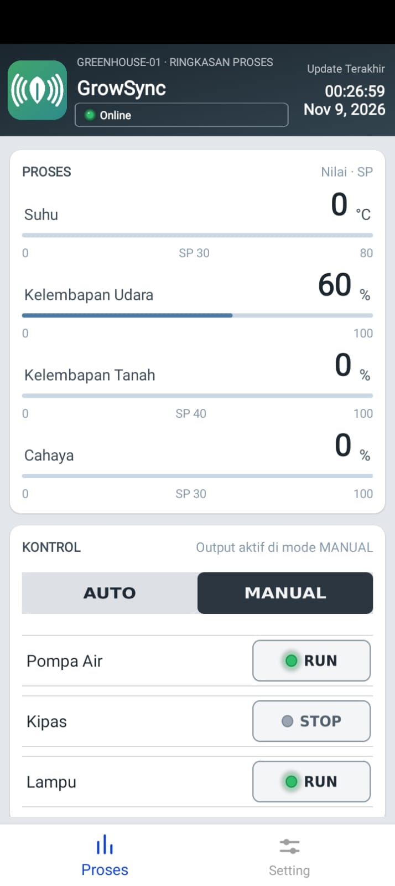
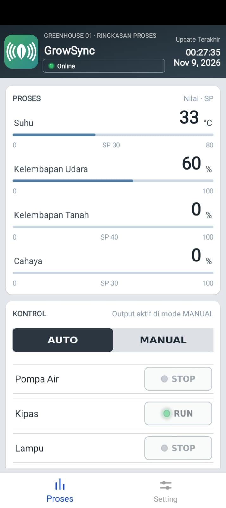
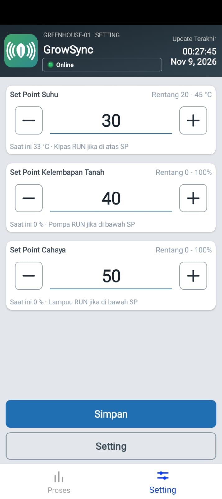

<div align="center">


# GrowSync

**Aplikasi Android untuk memantau dan mengendalikan greenhouse berbasis IoT (ESP32 + Firebase).**


[**📘 Panduan Penggunaan (PDF)**](docs/Panduan-Penggunaan-GrowSync.pdf)

</div>

---

## Tentang Proyek

**GrowSync** adalah aplikasi Android yang dibuat dengan [Kodular](https://www.kodular.io) untuk memonitor kondisi greenhouse secara *real-time* dan mengontrol aktuatornya (pompa air, kipas, dan lampu) dari ponsel. Aplikasi berkomunikasi dengan perangkat **ESP32** melalui **Firebase Realtime Database**, sehingga greenhouse bisa dipantau dari mana saja selama ada koneksi internet.

> Repositori ini berisi aplikasi Android (source Kodular, aset UI, dan logo). Firmware ESP32 tidak termasuk di sini — lihat [docs/FIREBASE.md](docs/FIREBASE.md) untuk struktur data yang harus dipakai firmware agar kompatibel.

## Panduan Penggunaan

Manual lengkap dengan petunjuk panah pada tampilan aplikasi: [`docs/Panduan-Penggunaan-GrowSync.pdf`](docs/Panduan-Penggunaan-GrowSync.pdf) (11 halaman). Isinya:

- pemasangan APK dan pengenalan halaman **Proses**;
- kontrol output pada mode **MANUAL** dan **AUTO**, termasuk logika bertoleransi;
- cara mengubah **set point** (buka kunci, ubah, simpan);
- arti status koneksi dan lampu indikator, pemecahan masalah, daftar istilah;
- penjelasan isi dan makna logo.

## Fitur

- **Monitoring real-time** — suhu, kelembapan udara, kelembapan tanah, dan intensitas cahaya, lengkap dengan bar progres dan nilai *set point* (SP).
- **Mode AUTO / MANUAL** — pada mode AUTO output menyala dan mati sendiri berdasarkan set point dengan logika sederhana bertoleransi; pada mode MANUAL pompa, kipas, dan lampu dikontrol langsung lewat tombol RUN/STOP. Pindah MANUAL → AUTO: output menyesuaikan AUTO. Pindah AUTO → MANUAL: output mempertahankan kondisi terakhir dari AUTO.
- **Pengaturan set point** — ubah SP suhu (20–45 °C), kelembapan tanah (0–100%), dan cahaya (0–100%) dengan tombol +/− atau mengetik angka, lalu simpan ke Firebase. Set point terkunci: ketuk tombol **Setting** dulu untuk membuka, dan **Simpan** akan mengunci kembali.
- **Indikator status koneksi** — empat status: **Offline** (abu-abu), **Connecting...** (kuning), **Online** (hijau), dan **Error** (merah), plus waktu *update* terakhir.
- **Navigasi dua halaman** — *Proses* (monitoring dan kontrol) dan *Setting* (set point).

### Logika otomatis (mode AUTO)

Aplikasi memakai logika fuzzy sederhana dengan **toleransi**: output menyala saat nilai sensor melewati SP dan baru mati setelah melewati batas toleransi. Di antara keduanya (zona tahan) output mempertahankan kondisi terakhir, sehingga tidak bolak-balik nyala-mati.

| Output | Sensor | RUN jika | STOP jika | Toleransi |
|---|---|---|---|---|
| Kipas | Suhu | suhu **> SP** | suhu **≤ SP − 1** | 1 °C |
| Pompa Air | Kelembapan tanah | tanah **< SP** | tanah **≥ SP + 3** | 3 % |
| Lampu | Cahaya | cahaya **< SP** | cahaya **≥ SP + 5** | 5 % |

Jika nilai sensor terbaca **0**, output dimatikan (STOP).

> **Catatan:** belum ada batas pengaman otomatis (misalnya batas waktu nyala) karena output belum memakai sensor feedback.

## Tampilan

<div align="center">



</div>

Screenshot lain ada di [`docs/screenshots/`](docs/screenshots). Mockup desain awal tersedia di [`docs/mockup/`](docs/mockup) (PDF, HTML, dan PNG).

## Arsitektur Singkat

```
┌──────────────┐   sensor / aktuator   ┌─────────┐   WiFi    ┌──────────────────────┐   internet   ┌──────────────┐
│ Greenhouse   │ ────────────────────► │  ESP32  │ ────────► │ Firebase Realtime DB │ ◄──────────► │ Aplikasi     │
│ (sensor, relay)│ ◄──────────────────  │         │ ◄──────── │                      │              │ GrowSync     │
└──────────────┘                       └─────────┘           └──────────────────────┘              └──────────────┘
```

## Spesifikasi Aplikasi

| | |
|---|---|
| Nama aplikasi | GrowSync |
| Package name | `com.growsync.greenhouse` |
| Versi | 1.3.15 (versioncode 1) |
| Minimum Android | 6.0 (API 23) |
| Orientasi | Portrait |
| Platform pembuat | Kodular Creator |
| Layar | `Screen1` (splash), `Dashboard` (Proses + Setting) |

### Ekstensi / komponen yang dipakai

- `KodularFirebaseDatabase` — komunikasi data dengan Firebase
- `KodularBottomNavigation` — navigasi bawah (Proses / Setting)
- `MakeroidCardView` dan `MakeroidLinearProgressbar` — kartu dan bar progres

## Instalasi

### Opsi 1 — Pasang APK

1. Ambil `GrowSync-v1.3.15.apk` dari folder [`release/`](release) (atau dari halaman **[Releases](../../releases)** setelah dipublikasikan).
2. Di Android, izinkan *Install from unknown sources* untuk aplikasi yang kamu pakai membuka file.
3. Buka APK dan pasang.

### Opsi 2 — Buka source di Kodular

1. Masuk ke [Kodular Creator](https://creator.kodular.io).
2. **My Projects → Import project (.aia)** lalu pilih [`source/GrowSync.aia`](source/GrowSync.aia).
3. Siapkan konfigurasi Firebase milikmu sendiri (lihat [docs/FIREBASE.md](docs/FIREBASE.md)).
4. Build lewat menu **Build → Android App (.apk)**.

Panduan lebih rinci ada di [docs/BUILD.md](docs/BUILD.md).

## Struktur Repositori

```
GrowSync/
├── release/
│   └── GrowSync-v1.3.15.apk        # APK siap pasang
├── source/                         # Source Kodular (.aia, export per layar .ais)
├── assets/                         # Aset UI untuk Kodular (PNG, kerapatan 3x)
├── branding/                       # Logo vektor (SVG): warna, gelap, putih
├── docs/
│   ├── Panduan-Penggunaan-GrowSync.pdf
│   ├── FIREBASE.md                 # Struktur data dan setup Firebase
│   ├── BUILD.md                    # Cara import dan build ulang
│   ├── pratinjau-aset-ui.png       # Pratinjau semua aset UI
│   ├── mockup/                     # Mockup desain (PDF, HTML, PNG)
│   └── screenshots/                # Screenshot asli aplikasi (01–07)
├── CHANGELOG.md
├── LICENSE
└── README.md
```

## Konfigurasi Firebase

File `google-services.json` **sengaja tidak disertakan** di repositori ini. Gunakan project Firebase milikmu sendiri dan ikuti langkahnya di [docs/FIREBASE.md](docs/FIREBASE.md). Template kosong tersedia di [`source/google-services.json.example`](source/google-services.json.example).

## Roadmap

- [ ] Riwayat data sensor (grafik)
- [ ] Notifikasi saat nilai sensor melewati batas
- [ ] Sensor feedback pada output dan batas pengaman (misalnya batas waktu nyala)
- [ ] Dukungan lebih dari satu greenhouse
- [ ] Autentikasi pengguna

## Pembuat

**Fikri Firmansyah** — Mahasiswa Teknik Elektro.

Jika proyek ini bermanfaat, silakan beri ⭐ pada repositori.

## Lisensi

Dirilis di bawah lisensi [MIT](LICENSE).
